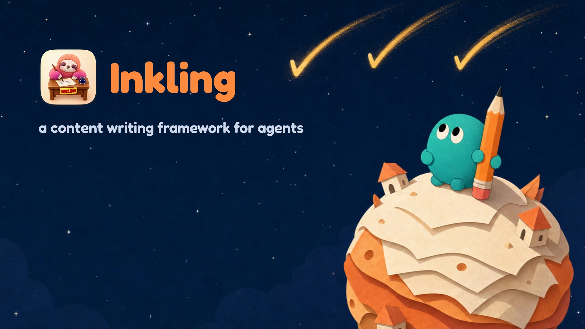

<p align="center">
  
</p>

<h1 align="center">Inkling</h1>

<p align="center">
  Inkling: content writing framework for agents.
</p>

Agents are great at writing code now, but still terrible at copy. This framework gets you and your agent to treat writing text like writing code: which tests can validate it? What would the audience reading it think? What is the goal we are trying to convey?

Agents stop once copy is accurate, because no test fails on it. You get a writing process your agent follows, tools it can pick up along the way, and the research behind both.

## Watch the lesson

<a href="https://inkling-lesson--langwatch-f9de22.lazeapps.com"></a>

A narrated video (6:50) on the six ways AI writing goes wrong and how this process fixes them, with chapters, captions and the full rule list. It opens in the team's Laze workspace.

## The process

When your agent writes something people will read, it goes through eight steps:

1. **[Who reads.](docs/process/1-who-reads.md)** A line on the reader: who they are, where they come from, what they know, what they are deciding.
2. **[Which mind.](docs/process/2-which-mind.md)** Pick the mind the reader needs: a seller, an engineer, a lawyer, an investor, or more than one.
3. **[The claim.](docs/process/3-one-claim.md)** The one thing the piece has to land, and what this reader would not expect.
4. **[Reader tests first.](docs/process/4-reader-tests.md)** Before any draft, write what each reader must take away.
5. **[Draft.](docs/process/5-draft.md)** Explain it to one reader who asked, the way you would say it, in the [reference voice](docs/voice/reference.md), from memory and with no outline. Then shape it for the reader and trim whole repeats, never the "so" and "because".
6. **[Check.](docs/process/6-check.md)** Look for the phrasing reviewers rejected before: hedges, slogans, contrast formulas, crammed headlines.
7. **[Reader test.](docs/process/7-reader-test.md)** Simulated readers read the draft and say what they would do next and where they would stop. Fix what stopped them.
8. **[Stop.](docs/process/8-stop.md)** Stop when the readers pass, or when the time you set runs out, and keep what readers still asked for the next piece.

## Start

Point your agent at this repo. In Claude Code or another coding agent, paste this line. In a chat app such as Claude or ChatGPT, paste it and turn on web access so it can read the repo:

```text
Follow the writing process at https://github.com/langwatch/inkling to write
```

The line only teaches your agent the process. Then tell it what you want written. If you already said it earlier in the chat, the agent works from that; if it still can't tell who will read the piece, it asks you before it drafts.

## Tools

The agent can pick these up at any step. None of them is required to follow the process.

| Tool | What it does | Cost |
| --- | --- | --- |
| [Lint](docs/tools/lint.md) | flags the phrasing reviewers rejected, with line, reason and fix | free, under a second |
| [Judge](docs/tools/judge.md) | asks Jev, a small paid model, one yes or no question per rule and line, for problems a pattern cannot see | about 0.0003 USD a paragraph, needs an application programming interface (API) key |
| [Reader panel](docs/tools/panel.md) | runs simulated readers from your reader tests, grades their answers, compares versions unlabelled, then one clean-eyes round | Claude subscription |
| [Budget](docs/tools/budget.md) | sets the time, stops at the best version, lists what is open | free |
| [Calibration](docs/tools/calibration.md) | measures the rules on lines people already approved and rejected | free |

Run them from any folder. They need Node 22 or newer:

```sh
npx -y github:langwatch/inkling check draft.md --mode ads --audience "founders who just searched for an agent sandbox"
npx -y github:langwatch/inkling judge draft.md --mode ads        # needs TYPESAFE_API_KEY and Python 3
npx -y github:langwatch/inkling readers panel start draft.md draft.readers.yaml --out runs/launch
```

The reader panel runs on a Claude subscription, through Claude Code subagents or `claude -p`, and refuses to start when a paid model provider key is set. The judge is the only tool that needs a paid key. For a local install: `git clone https://github.com/langwatch/inkling && cd inkling && npm link`, then `inkling --help`.

A reviewer rejected the first three of these four titles:

```sh
inkling check examples/sandbox-titles/titles.md --mode ads \
  --audience "founders who just searched for an agent sandbox, deciding whether to click"
```

```text
examples/sandbox-titles/titles.md:1:3  contrast/mirrored-pair
  > A sandbox runs your agent. ACME puts it to work for your team
  why: "X does A. Y does B." mirrored pair: one idea dressed as two.
  fix: Keep the one claim the reader did not expect.

examples/sandbox-titles/titles.md:1:3  pitch/crammed-headline
  > A sandbox runs your agent. ACME puts it to work for your team
  why: Headline crams more than one claim. 13 words.
  fix: Cut to the one claim this reader did not expect.

examples/sandbox-titles/titles.md:3:14  contrast/doesnt-need-needs
  > Your agent doesn't need a sandbox. It needs a team.
  why: "Doesn't need X. It needs Y." contrast formula.
  fix: Keep one flat claim: "You don't need an agent sandbox".

examples/sandbox-titles/titles.md:5:24  numbers/number-in-title
  > Dashboards come with 77 ready-made questions
  why: A bare count in the title reads as a listicle.
  fix: Title the claim; carry the count in the body with its comparison.

4 findings from 4 rules.
```

The fourth title, "You don't need an agent sandbox", gets no finding. The full output is in [output.txt](examples/sandbox-titles/output.txt), and the Jev judge on the same titles is in [judge-output.txt](examples/sandbox-titles/judge-output.txt).

For a narrated lesson or video, `--mode script --minutes 3`, `inkling voice` and `inkling readers listen` check the script by ear; see [spoken scripts](docs/process/script-mode.md) and the [talking-voice profile](docs/voice/profile.md).

More tools: [preference judge](docs/tools/preference.md), [surprise](docs/tools/surprise.md), [images](docs/tools/images.md), [known false positives](docs/tools/known-false-positives.md).

## Research

- **[Why agents write bad copy](docs/research/why.md).** The nine reasons, from an agent explaining its own rejected titles and a study showing that a large language model (LLM) asked to grade text prefers text a model wrote.
- **[Patterns](docs/research/lessons.md).** The review notes every rule came from.
- **[Why drafts came out as notes](docs/research/note-voice.md).** How an outline-first draft and label-shaped fixes turned a lesson script into compressed notes, and what the draft step does now.
- **Examples.** [Approved and rejected lines](calibration/regression.jsonl), [pairs for the preference judge](calibration/pairs.jsonl) and [the sandbox titles](examples/sandbox-titles/).
- **Studies.** [Judge bias](docs/research/judge-bias.md), with the [Meta study](https://facebookresearch.github.io/RAM/blogs/unslop/) and [paper](https://arxiv.org/abs/2610.38882), and [surprise](docs/research/surprise-study.md).
- **[Origin](docs/research/origin.md).** The conversation that started Inkling.

## What works today

The lint, judge, reader panel, budget and calibration tools work and have tests (`npm test`). The preference judge is advisory until its pair set reaches 30 held-out pairs. Surprise is a design with a prototype. No preset is calibrated yet. The [self-check](docs/dogfood.md) records Inkling run on its own docs; see also the [roadmap](docs/roadmap.md) and [credits](docs/credits.md).
